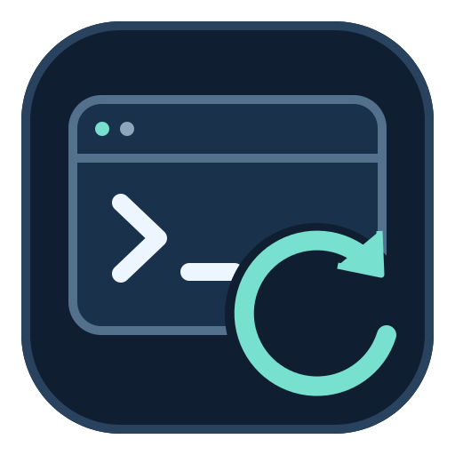
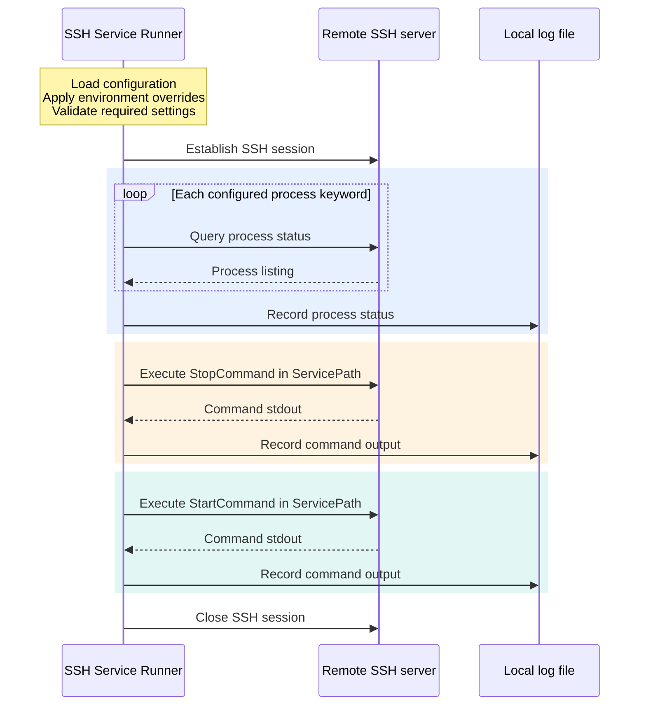

<p align="center">
  
</p>

<h1 align="center">SSH Service Runner</h1>

<p align="center">
  <a href="pyproject.toml"></a>
  <a href="uv.lock"></a>
  <a href="core/service.py"></a>
  <a href="LICENSE"></a>
</p>

<p align="center">
  <a href="README.md" lang="en">English</a> · <a href="README.zh-CN.md" lang="zh-CN">简体中文</a>
</p>

---

SSH Service Runner is a Python application for inspecting and restarting remote services over SSH. Connection parameters, process keywords, and service commands are configured through YAML files or environment variables. Dependencies and the runtime environment are managed with [uv](https://docs.astral.sh/uv/).

## Execution flow



The application runs locally and coordinates remote operations within an SSH session. After configuration validation, it queries the configured process keywords, then executes `StopCommand` followed by `StartCommand` in `ServicePath`. Process status and command standard output are recorded locally. The session is closed after normal completion.

> [!NOTE]
> Process inspection provides status information and does not determine whether the restart commands execute. Remote command exit codes are not evaluated; see [Current behavior and limitations](#current-behavior-and-limitations).

## Features

- 🔐 Connect to a remote server with Paramiko.
- 🔎 Check processes using configurable keywords.
- 🔄 Execute the configured stop command, followed by the start command.
- ⚙️ Keep server settings and credentials in ignored local configuration or environment variables.
- 📝 Write execution logs to a configurable UTF-8 log file.

## Requirements

- [uv](https://docs.astral.sh/uv/getting-started/installation/) installed and available on `PATH`.
- Python 3.10 or newer. `.python-version` selects Python 3.12 by default; uv can install that interpreter when needed.
- An SSH-accessible remote server with a POSIX shell, `ps`, and `grep`.
- An SSH account with permission to inspect processes and execute your service scripts.

The local launcher can run on Windows, Linux, or macOS. The remote process check expects a Unix-like environment.

## Quick start

Clone the repository and install the dependencies:

```shell
git clone <repository-url> ssh-service-runner
cd ssh-service-runner
uv sync --locked
```

Create your local configuration:

```powershell
# Windows PowerShell
Copy-Item config/config.yml config/config.local.yml
```

```sh
# Linux / macOS
cp config/config.yml config/config.local.yml
```

Edit `config/config.local.yml` for your server. For example:

```yaml
HostInfo:
  IP: "ssh.example.com"
  Port: 22

UserInfo:
  Username: "deploy"
  Password: ""  # Set SSH_SERVICE_RUNNER_PASSWORD for password authentication.

PceKeys:
  - "my-service"

ServicePath: "/opt/my-service"
StartCommand: "./start.sh"
StopCommand: "./stop.sh"
```

For password authentication, set the password in your environment before running:

```powershell
$env:SSH_SERVICE_RUNNER_PASSWORD = [System.Net.NetworkCredential]::new("", (Read-Host "SSH password" -AsSecureString)).Password
```

```bash
read -rs -p "SSH password: " SSH_SERVICE_RUNNER_PASSWORD
export SSH_SERVICE_RUNNER_PASSWORD
echo
```

Then run:

```shell
uv run --locked python start.py
```

> [!WARNING]
> **Running the script restarts the configured service.** Every run checks processes, logs the result, executes `StopCommand`, executes `StartCommand`, and closes the SSH connection on the normal completion path. The process check is informational: a missing process does not skip the restart.

The committed `config/config.yml` is a template with empty connection and command fields. Fill in your local settings before running; incomplete configuration fails before connecting to a server.

## Configuration

### File selection

The first available choice below is used as the complete configuration file:

1. An explicit path passed to `Config(config_path=...)` in Python.
2. The path in `SSH_SERVICE_RUNNER_CONFIG`.
3. `config/config.local.yml`, if it exists.
4. The committed `config/config.yml` template.

Files are not merged. Environment variables override individual values in the selected file. Relative paths in `SSH_SERVICE_RUNNER_CONFIG` are resolved from the current working directory; the default configuration paths are relative to the project itself.

### YAML fields

| Field | Description | Default / requirement |
| --- | --- | --- |
| `HostInfo.IP` | SSH hostname or IP address | Required |
| `HostInfo.Port` | SSH port | `22`; integer from `1` to `65535` |
| `UserInfo.Username` | SSH username | Required |
| `UserInfo.Password` | SSH password | Empty string; must be a string |
| `PceKeys` | Process keywords used by the existing `ps` / `grep` check | Empty list; skips process checks |
| `ServicePath` | Remote working directory for both commands | Required |
| `StartCommand` | Remote service start command | Required |
| `StopCommand` | Remote service stop command | Required |

With an empty password, Paramiko retains its default SSH agent and discoverable key lookup. This project does not add custom key-file options. Quote passwords and other string values in YAML to prevent automatic conversion to numbers or booleans.

### Environment variables

| Variable | Overrides |
| --- | --- |
| `SSH_SERVICE_RUNNER_CONFIG` | Configuration file location |
| `SSH_SERVICE_RUNNER_HOST` | `HostInfo.IP` |
| `SSH_SERVICE_RUNNER_PORT` | `HostInfo.Port` |
| `SSH_SERVICE_RUNNER_USERNAME` | `UserInfo.Username` |
| `SSH_SERVICE_RUNNER_PASSWORD` | `UserInfo.Password` |
| `SSH_SERVICE_RUNNER_PROCESS_KEYWORDS` | `PceKeys`, as a JSON array, e.g. `["my-service"]` |
| `SSH_SERVICE_RUNNER_SERVICE_PATH` | `ServicePath` |
| `SSH_SERVICE_RUNNER_START_COMMAND` | `StartCommand` |
| `SSH_SERVICE_RUNNER_STOP_COMMAND` | `StopCommand` |
| `SSH_SERVICE_RUNNER_LOG_FILE` | Log file location |

Legacy `WINEXCSSH_*` environment variables remain supported. The corresponding `SSH_SERVICE_RUNNER_*` value takes precedence when both are set.

`.env` files are ignored by Git but are not loaded automatically. Export variables in your shell or provide them through your execution environment.

### Logging

Logs are written to `logs/ssh-service-runner.log` by default. The directory is created automatically. Set `SSH_SERVICE_RUNNER_LOG_FILE` to use another file; relative overrides are resolved from the current working directory. Logs can include process listings and remote command output, so keep them private.

Application error messages and launcher prompts are in English. Remote command output is preserved as returned by the server.

## Windows desktop shortcut

Double-click `start.bat`, or create a desktop shortcut to that file. It finds the project relative to its own location and runs `uv run --locked python start.py`; no machine-specific path needs editing. Ensure `uv` is available on the Windows `PATH`.

The terminal stays open so that you can read errors. Use `assets/ssh-service-runner.ico` as the shortcut icon. The editable icon source and export details are in [`assets/README.md`](assets/README.md).

## Development

```shell
uv sync --locked
uv run --locked python -m unittest discover -s tests -v
```

The tests use temporary configuration files and mocked SSH clients. They do not connect to a real server or execute remote commands.

The repository includes `uv.lock` for reproducible dependency versions. Use `uv sync --locked` and `uv run --locked ...` to reject unexpected lockfile changes. An initial sync requires access to the Python package index and may download the Python version selected by `.python-version`.

To update dependencies intentionally:

```shell
uv lock --upgrade
uv sync --locked
uv run --locked python -m unittest discover -s tests -v
```

Commit `pyproject.toml` and `uv.lock` together when changing dependencies. This is a uv application project, not an installable Python package; run it from the repository using uv. No manual `PYTHONPATH` setup is required, and the checkout directory can be renamed.

## Current behavior and limitations

- The SSH connection timeout remains 10 seconds.
- Unknown SSH host keys are accepted using Paramiko's existing `AutoAddPolicy`; verify server identity through a trusted channel before use.
- Process detection retains the original `ps -ef | grep <keyword>` behavior and process-count heuristic. Choose specific keywords appropriate for your server.
- Service paths and commands are passed to the remote shell using the original `cd <path> ; <command>` format. Configure shell quoting yourself when needed and use only trusted configuration.
- Remote exit codes and stderr are not checked. A completed local run does not establish that a remote service started successfully; confirm its state on the server.

## Contributing

Issues and pull requests are welcome. Describe the problem, expected behavior, and how to reproduce it without including credentials or private server details. For code changes, run the test command above and document any configuration changes.

Keep real credentials out of tracked files. Before publishing an existing checkout, rotate any previously committed credentials and remove them from Git history; replacing the current configuration does not remove earlier revisions.

## License

This project is licensed under the [MIT License](LICENSE).
