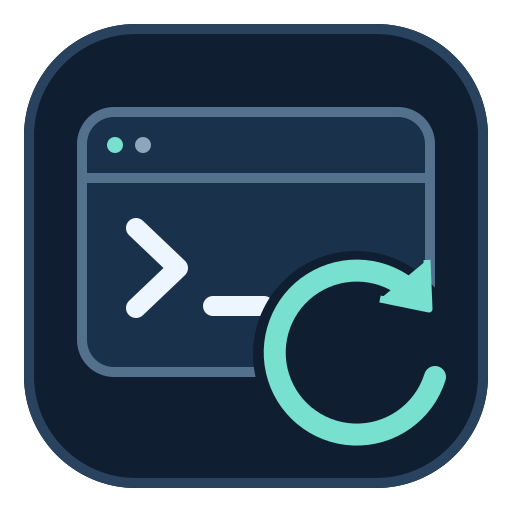
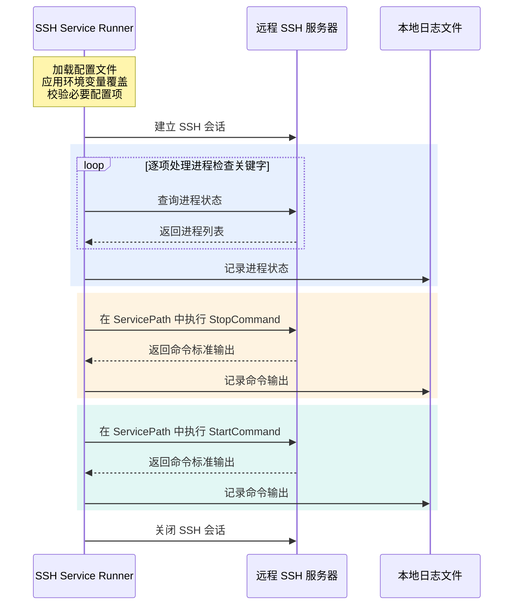

<p align="center">
  
</p>

<h1 align="center">SSH Service Runner</h1>

<p align="center">
  <a href="pyproject.toml"></a>
  <a href="uv.lock"></a>
  <a href="core/service.py"></a>
  <a href="LICENSE"></a>
</p>

<p align="center">
  <a href="README.md" lang="en">English</a> · <a href="README.zh-CN.md" lang="zh-CN">简体中文</a>
</p>

---

SSH Service Runner 是一个通过 SSH 检查和重启远程服务的 Python 工具。服务器连接参数、进程检查关键字和服务命令通过 YAML 文件或环境变量配置，使用 [uv](https://docs.astral.sh/uv/) 管理依赖与运行环境。

## 执行流程



程序在本地运行，通过 SSH 会话协调远程操作。配置校验通过后，程序根据配置的关键字查询进程状态，随后在 `ServicePath` 中依次执行 `StopCommand` 和 `StartCommand`。进程状态与命令标准输出写入本地日志，执行正常完成后关闭会话。

> [!NOTE]
> 进程检查仅提供状态信息，不决定是否执行重启命令。程序不检查远程命令退出码，具体限制参见[当前行为与限制](#当前行为与限制)。

## 功能

- 🔐 使用 Paramiko 连接远程服务器。
- 🔎 根据可配置的关键字检查进程。
- 🔄 依次执行配置的停止命令和启动命令。
- ⚙️ 通过 Git 忽略的本地配置或环境变量保存服务器设置与凭据。
- 📝 将执行日志写入可配置的 UTF-8 日志文件。

## 环境要求

- 已安装 [uv](https://docs.astral.sh/uv/getting-started/installation/)，且可在 `PATH` 中找到。
- Python 3.10 或更新版本。`.python-version` 默认选择 Python 3.12，uv 可在需要时安装该版本。
- 可通过 SSH 访问的远程服务器，提供 POSIX shell、`ps` 和 `grep`。
- SSH 账号具备查看进程和执行服务脚本的权限。

本地启动程序可在 Windows、Linux 或 macOS 上运行。远程进程检查要求服务器提供类 Unix 环境。

## 快速开始

克隆仓库并安装依赖：

```shell
git clone <repository-url> ssh-service-runner
cd ssh-service-runner
uv sync --locked
```

创建本地配置：

```powershell
# Windows PowerShell
Copy-Item config/config.yml config/config.local.yml
```

```sh
# Linux / macOS
cp config/config.yml config/config.local.yml
```

根据服务器情况编辑 `config/config.local.yml`，例如：

```yaml
HostInfo:
  IP: "ssh.example.com"
  Port: 22

UserInfo:
  Username: "deploy"
  Password: ""  # 使用密码认证时，设置 SSH_SERVICE_RUNNER_PASSWORD。

PceKeys:
  - "my-service"

ServicePath: "/opt/my-service"
StartCommand: "./start.sh"
StopCommand: "./stop.sh"
```

使用密码认证时，在运行前通过环境变量设置密码：

```powershell
$env:SSH_SERVICE_RUNNER_PASSWORD = [System.Net.NetworkCredential]::new("", (Read-Host "SSH password" -AsSecureString)).Password
```

```bash
read -rs -p "SSH password: " SSH_SERVICE_RUNNER_PASSWORD
export SSH_SERVICE_RUNNER_PASSWORD
echo
```

然后运行：

```shell
uv run --locked python start.py
```

> [!WARNING]
> **运行脚本会重启配置的服务。** 每次运行都会检查进程、记录结果、执行 `StopCommand`、执行 `StartCommand`，并在正常完成后关闭 SSH 连接。进程检查只提供状态信息；没有找到进程时，程序仍会执行停止和启动命令。

仓库中的 `config/config.yml` 是模板，连接信息和命令字段均为空。请先填写本地配置；配置不完整时，程序会在连接服务器之前报错。

## 配置说明

### 配置文件选择

程序按以下顺序选择首个适用的文件，作为完整配置：

1. 在 Python 中通过 `Config(config_path=...)` 显式传入的路径。
2. 环境变量 `SSH_SERVICE_RUNNER_CONFIG` 指定的路径。
3. `config/config.local.yml`，如果该文件存在。
4. 仓库中的 `config/config.yml` 模板。

配置文件之间不会合并。环境变量会覆盖所选文件中的对应字段。`SSH_SERVICE_RUNNER_CONFIG` 中的相对路径以当前工作目录为基准；默认配置文件路径以项目目录为基准。

### YAML 字段

| 字段 | 说明 | 默认值或要求 |
| --- | --- | --- |
| `HostInfo.IP` | SSH 主机名或 IP 地址 | 必填 |
| `HostInfo.Port` | SSH 端口 | `22`；取值为 `1` 至 `65535` 的整数 |
| `UserInfo.Username` | SSH 用户名 | 必填 |
| `UserInfo.Password` | SSH 密码 | 默认为空字符串；必须是字符串 |
| `PceKeys` | 原有 `ps` / `grep` 检查使用的进程关键字 | 默认为空列表，此时跳过进程检查 |
| `ServicePath` | 两条命令使用的远程工作目录 | 必填 |
| `StartCommand` | 远程服务启动命令 | 必填 |
| `StopCommand` | 远程服务停止命令 | 必填 |

密码为空时，Paramiko 会保留默认的 SSH agent 和本地密钥查找行为。本项目未增加自定义密钥文件参数。请为 YAML 中的密码和其他字符串值加上引号，避免它们被自动解析为数字或布尔值。

### 环境变量

| 变量 | 覆盖的配置 |
| --- | --- |
| `SSH_SERVICE_RUNNER_CONFIG` | 配置文件路径 |
| `SSH_SERVICE_RUNNER_HOST` | `HostInfo.IP` |
| `SSH_SERVICE_RUNNER_PORT` | `HostInfo.Port` |
| `SSH_SERVICE_RUNNER_USERNAME` | `UserInfo.Username` |
| `SSH_SERVICE_RUNNER_PASSWORD` | `UserInfo.Password` |
| `SSH_SERVICE_RUNNER_PROCESS_KEYWORDS` | `PceKeys`，使用 JSON 数组，例如 `["my-service"]` |
| `SSH_SERVICE_RUNNER_SERVICE_PATH` | `ServicePath` |
| `SSH_SERVICE_RUNNER_START_COMMAND` | `StartCommand` |
| `SSH_SERVICE_RUNNER_STOP_COMMAND` | `StopCommand` |
| `SSH_SERVICE_RUNNER_LOG_FILE` | 日志文件路径 |

仍支持旧的 `WINEXCSSH_*` 环境变量。新旧变量同时设置时，对应的 `SSH_SERVICE_RUNNER_*` 变量优先生效。

`.env` 文件已被 Git 忽略，但程序不会自动加载它。请在 shell 中导出变量，或由运行环境提供这些变量。

### 日志

日志默认写入 `logs/ssh-service-runner.log`，目录会自动创建。可通过 `SSH_SERVICE_RUNNER_LOG_FILE` 指定其他文件；该变量中的相对路径以当前工作目录为基准。日志可能包含进程列表和远程命令输出，请妥善保管。

程序错误信息和启动提示统一使用英文。远程命令输出按服务器返回的内容保留。

## Windows 桌面快捷方式

双击 `start.bat`，或为该文件创建桌面快捷方式。启动脚本会根据自身所在位置定位项目，并运行 `uv run --locked python start.py`，无需修改机器专属的绝对路径。请确保 Windows 的 `PATH` 中可以找到 `uv`。

终端会保持打开，方便查看错误。快捷方式图标可使用 `assets/ssh-service-runner.ico`。可编辑的图标源文件与导出说明见 [`assets/README.md`](assets/README.md)。

## 开发与测试

```shell
uv sync --locked
uv run --locked python -m unittest discover -s tests -v
```

测试使用临时配置文件和模拟的 SSH 客户端，不会连接真实服务器或执行远程命令。

仓库包含 `uv.lock`，用于固定依赖版本。使用 `uv sync --locked` 和 `uv run --locked ...` 可避免锁文件被意外修改。首次安装依赖需要访问 Python 包索引，也可能下载 `.python-version` 指定的 Python 版本。

需要主动升级依赖时，执行：

```shell
uv lock --upgrade
uv sync --locked
uv run --locked python -m unittest discover -s tests -v
```

修改依赖时，请同时提交 `pyproject.toml` 和 `uv.lock`。本工程是 uv 应用项目，不作为可安装的 Python 包发布；请在仓库中使用 uv 运行。无需手动设置 `PYTHONPATH`，也可以修改本地检出目录的名称。

## 当前行为与限制

- SSH 连接超时仍为 10 秒。
- 保留 Paramiko `AutoAddPolicy` 的现有行为，会接受未知的 SSH 主机密钥；使用前请通过可信渠道核实服务器身份。
- 进程检测保留原有的 `ps -ef | grep <keyword>` 命令和进程数量估算方式，请选择适合服务器环境且足够具体的关键字。
- 服务路径和命令仍按 `cd <path> ; <command>` 格式传递给远程 shell。需要时请自行处理 shell 引号，并仅使用可信配置。
- 程序不会检查远程退出码和标准错误输出。本地运行结束并不代表远程服务已成功启动，请在服务器上确认服务状态。

## 参与贡献

欢迎提交 Issue 和 Pull Request。请描述问题、预期行为及复现方式，不要附带凭据或私有服务器信息。修改代码后，请运行上述测试命令，并说明配置方面的变更。

不要将真实凭据提交到受 Git 跟踪的文件。公开已有仓库前，请更换曾提交过的凭据，并将它们从 Git 历史中清除；仅修改当前配置不会删除旧提交中的内容。

## 许可证

本项目使用 [MIT 许可证](LICENSE)。
